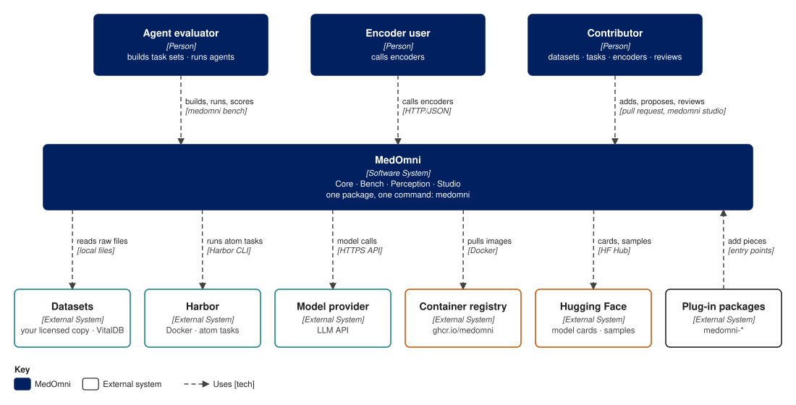

# MedOmni

MedOmni is a benchmark that runs AI agents on medical tasks across many data modalities and scores what they do.

Each task gives an agent one patient's evidence (tables, waveforms, images, notes) and asks a clinical question. The agent can call perception encoders as tools, and a fixed verifier scores its answer. Like Terminal-Bench and SWE-bench, MedOmni measures agent behaviour, not a single model.

!!! info "This is v0.2.0"
    These docs describe MedOmni v0.2.0, the ICLR 2027 submission version (git tag `v0.2.0`). It is the first version that works end to end, from raw clinical data to scored agent runs. It runs from a checkout of the repository on a machine with credentialed access to the datasets. There is no installable package or single command yet.

!!! warning "No patient data ships with MedOmni"
    The repository holds code, contracts and task specs. Tasks are built locally from MIMIC-IV, AI-READI and BDSP, which you must be licensed to use.

## Who it is for

| You are | You want to | Start here |
|---|---|---|
| **Model tester** | Run an agent on MedOmni tasks and read the scores | [Run your agent](guides/run-your-agent.md) |
| **Perception service user** | Call the MedOmni encoders over HTTP | [Use the encoders](guides/use-the-encoders.md) |
| **Task or encoder author** | Add a task, an agent config or an encoder | [Contribute](guides/contribute.md) |

## How it fits together

The repository has three team areas and a harness:

- **`data_task/`** turns raw datasets into tasks: input families, task specs and the task builder.
- **`perception/`** holds the encoders, one container image each, and the gateway that serves them over HTTP.
- **`assurance/`** audits families, tasks, encoders and runs against what they claim.
- **`harness/`** runs agents on tasks under [Harbor](https://github.com/laude-institute/harbor) and scores the results.

Run traces and the ledger of results stay on the local machine under `runs/`.

## Where next

- [Get started](get-started.md): set up a checkout and run a first experiment.
- [Concepts](learn/concepts.md): the terms used across these docs.
- [Architecture](learn/architecture.md): how the parts fit, in three views.
