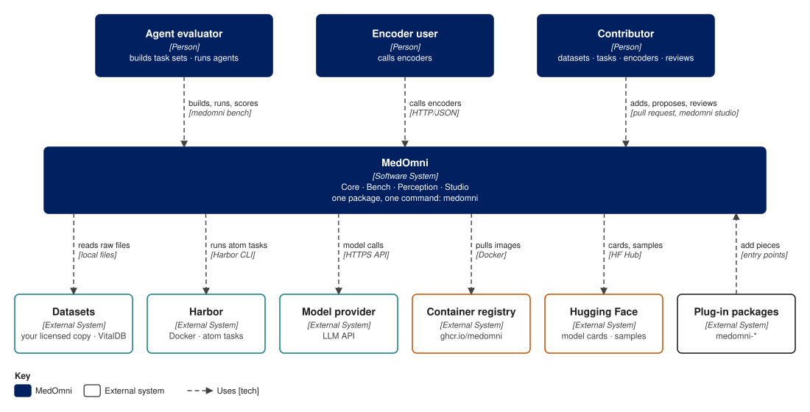
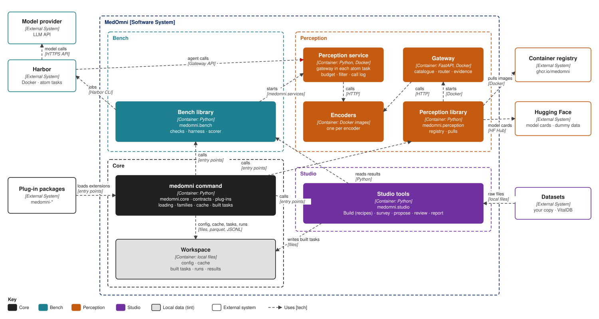
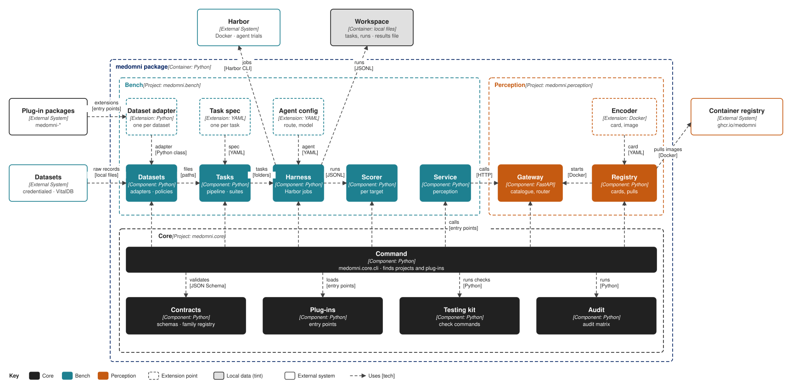
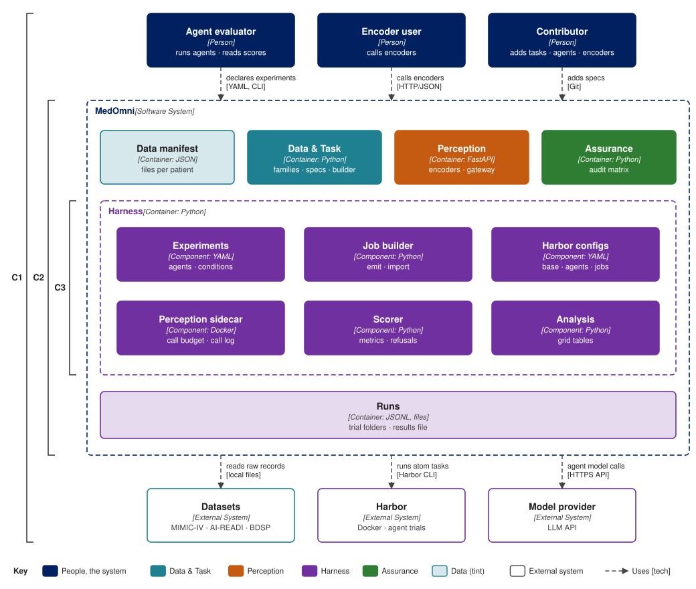

# Architecture

MedOmni v0.3.0 in five views:

- the repository layout
- who uses it ([C4](https://c4model.com) C1)
- its containers (C2)
- the components inside the `medomni` package (C3)
- C1 to C3 nested in one picture

## Repository layout

The repository holds one package, `medomni`: Core and three projects. Code is under `src/`; content that people write and review (families, dataset packages, task templates, cohorts, task sets, agent configs, encoders) is in one top-level folder per project. The starting files that each `new` command writes are inside the package. The toolkit has code only.

```text
MedOmni/
├── src/medomni/
│   ├── core/                 medomni.core
│   │   ├── cli/              the medomni command
│   │   ├── contracts/        typed models, validators, schemas/
│   │   ├── plugins/          entry-point loading
│   │   ├── loading/          format readers (CSV, OMOP, folder trees, recording headers) and the loader
│   │   ├── recipes/          the recipe format: cohorts, labels, evidence
│   │   ├── families/         registry loader, family converters, dummy-data generator
│   │   ├── cache/            cache keys, entries, cache commands
│   │   ├── testing/          runs the checks each project registers
│   │   └── audit/            runs the audit checks each project registers
│   ├── bench/                medomni.bench
│   │   ├── build/            Build: task steps, draw, checks, task sets, fingerprints
│   │   ├── harness/          Harbor jobs, route check, run records
│   │   ├── service/          the perception service in each atom task
│   │   └── scoring/          scorer, metrics, behaviour metrics
│   ├── perception/           medomni.perception
│   │   ├── registry/         catalogue, image pulls, encoder check
│   │   ├── runtime/          serving code built into every encoder image
│   │   └── gateway/          the HTTP service
│   └── toolkit/              medomni.toolkit: recipe preview, download list, Make scripts
├── core/
│   └── families/             one file per family, and aliases.yaml
├── bench/
│   ├── datasets/<dataset>/   dataset package: dataset.yaml, labels.yaml, evidence.yaml,
│   │                         codes.csv, policy.yaml, hooks/, tasks/<template>/
│   ├── sets/                 task sets: pinned <template>@<cohort> lists
│   └── agents/               contributed agent configs
├── perception/
│   └── encoders/             <family>/<encoder>/: built into images, not installed
├── tests/                    core/, bench/, perception/, toolkit/
├── docs/                     this site
└── pyproject.toml
```

- **One name per project.** Its package, content folder, command and docs section use the same name: `medomni.perception`, `perception/`, `medomni perception …`, Perception.
- **Code and content are apart.** A new dataset, task, family or encoder changes content only; the code that reads it is unchanged.
- **Projects depend only on Core.** Bench and Perception never import each other. The toolkit may also import Bench; nothing imports the toolkit. They register their commands, checks and audit checks with Core; see [How Core finds the projects](#how-core-finds-the-projects). [Design principles](principles.md#structure) gives the rules.
- **One page per component.** Core: [Contracts](core/contracts.md), [Families](core/families.md), [Cache](core/cache.md), [Plug-ins](core/plugins.md), [Audit](core/audit.md). Bench: [Datasets](bench/datasets.md), [Tasks](bench/tasks.md), [Build](bench/build.md), [Recipes](bench/recipes.md), [Runs](bench/runs.md), [Scoring](bench/scoring.md). Toolkit: [Toolkit](toolkit.md). Perception: [Encoders](perception/encoders.md), [Gateway](perception/gateway.md).

## Context (C1)



- **Agent evaluator**: describes an agent, builds a task set from their own data, runs the agent on it with Bench, reads the scores.
- **Encoder user**: calls the encoders through Perception's gateway.
- **Contributor**: adds an agent, a dataset, a task or an encoder through its extension point, and makes tasks with the toolkit.
- **MedOmni**: one package with one command, holding Core, Bench, Perception and the toolkit.
- **Plug-in packages**: outside `medomni-*` packages that add agents, datasets, tasks or encoders without a pull request.
- **Datasets**: MIMIC-IV, AI-READI and BDSP under your own license, and VitalDB, read from local disk.
- **Harbor**: the agent-evaluation framework that runs each atom task in Docker.
- **Model provider**: the API behind an agent's model on a `cloud` route. A `local` route needs none.
- **Container registry**: the published gateway and encoder images (`ghcr.io/medomni`).
- **Hugging Face**: model cards and the public task samples of open datasets.

## Containers (C2)



| Container | Project | Does |
|---|---|---|
| `medomni` command | Core | The entrance: finds the projects and any plug-in packages through entry points, then hands each subcommand to its project. |
| Workspace | Core | Configuration, the cache, built atom tasks, runs and the results file, on your machine. Never committed. |
| Bench library | Bench | Builds atom tasks from your data, turns a task set into Harbor jobs, records runs and scores them. |
| Perception service | Bench | Runs inside each atom task with encoders: Perception's gateway, with Bench's call budget, family filter and call log. |
| Perception library | Perception | Pulls encoder images, starts the gateway and checks encoders. |
| Gateway | Perception | The HTTP service in front of every encoder: its catalogue finds encoders and serves model cards, its router sends each call to a running encoder container. |
| Encoders | Perception | One image per encoder, each reading one family. Published to the container registry; model cards to Hugging Face. |
| Toolkit | Toolkit | Previews recipes on your copy, lists files to download, and holds the scripts for making tasks. |

Gateway and encoder images are tagged with the MedOmni release that built them. The gateway runs any encoder image built since the Container API last changed.

## Components of the package (C3)



| Project | Component | Module | Does |
|---|---|---|---|
| Core | Command | `medomni.core.cli` | The `medomni` command. Finds each project's subcommands through entry points; see [Commands](../cli/index.md). |
| Core | Contracts | `medomni.core.contracts` | The versioned formats, each with a typed model and a validator. See [Contracts](core/contracts.md). |
| Core | Plug-ins | `medomni.core.plugins` | Loads the projects and plug-in packages through their entry points. |
| Core | Testing kit | `medomni.core.testing` | Runs the checks each project registers. Plug-in packages import it for their own CI. |
| Core | Audit | `medomni.core.audit` | Runs the audit checks each project registers and writes the [audit](../reference/audit.md) report. |
| Core | Loading | `medomni.core.loading` | The format readers, and the loader that runs a dataset package through them into its event table. |
| Core | Recipes | `medomni.core.recipes` | The recipe format for cohorts, labels and evidence. |
| Core | Families | `medomni.core.families` | The family registry, the family converters and the dummy-data generator. |
| Core | Cache | `medomni.core.cache` | Cache keys and entries, and the cache commands. See [Cache](core/cache.md). |
| Bench | Build | `medomni.bench.build` | Runs recipes into atom tasks; task sets and fingerprints. See [Build](bench/build.md). |
| Bench | Harness | `medomni.bench.harness` | Turns a task set into Harbor jobs, checks the route against each dataset policy and records runs. |
| Bench | Scorer | `medomni.bench.scoring` | Scores complete tasks, one score record per target. The only thing that writes scores. |
| Bench | Perception service | `medomni.bench.service` | Runs the gateway inside each atom task, with the call budget, family filter and call log. |
| Perception | Gateway | `medomni.perception.gateway` | The gateway service, built into the gateway image. |
| Perception | Registry | `medomni.perception.registry` | The encoder catalogue: model cards, images, pulls and the encoder check. |
| Toolkit | Toolkit | `medomni.toolkit` | The recipe preview, the download list and the Make scripts. |

The projects meet in one contract: the perception service calls Perception's gateway through the Gateway API. Bench imports no Perception code.

Contributors and plug-in packages add agents, datasets, tasks and encoders to the projects; [Extend MedOmni](extend.md) lists each extension point with its template and check.

## How Core finds the projects

Core is the `medomni` command and the shared machinery. It imports no project; each project tells Core what it adds, through the `medomni.projects` entry-point group in MedOmni's own `pyproject.toml`:

- its subcommands, such as `medomni bench …`
- the checks behind its check commands
- its audit checks

This is internal wiring, done once per project. Users never do it; a later project joins the same way. Outside packages that add pieces use [plug-ins](core/plugins.md) instead.

## All levels



## Where next

- [Design principles](principles.md): the principles behind this layout.
- [Reference](../reference/tasks.md): the contracts each project reads and writes.
- [Commands](../cli/index.md): every subcommand.
